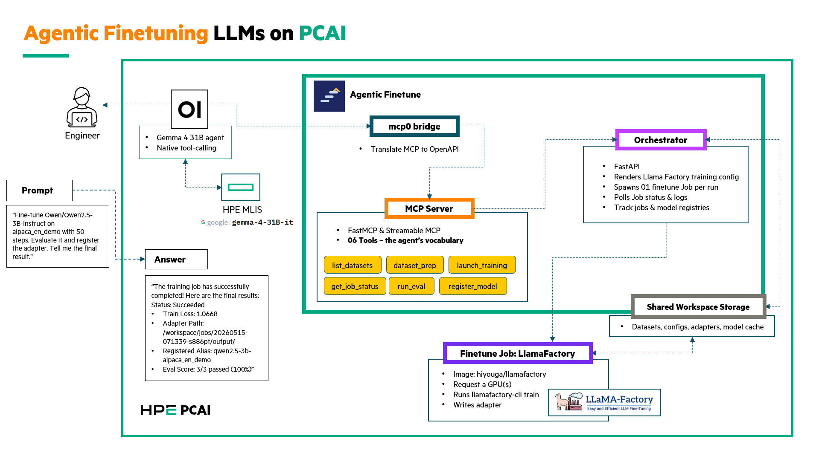

# Agentic Finetune

| Owner                 | Name       | Email             |
| --------------------- | ---------- | ----------------- |
| Use Case Owner        | Daniel Cao | daniel.cao@hpe.com|
| PCAI Deployment Owner | Daniel Cao | daniel.cao@hpe.com|

*Use case Owner: who brought (or created) this demo. Can be contacted to get more information*

*PCAI Deployment Owner: who helped to port the demo to PCAI. Can be contacted on deployment issues*

## Abstract

Fine-tuning has become a routine production workflow, but the engineer's day-to-day still involves a manual chain of dataset preparation, YAML config authoring, `kubectl` invocations, log tailing, evaluation, merge/export, and model registration. Most of that work is mechanical coordination, not judgment. This demo replaces that chain with a single conversational interface: an agent in Open-WebUI exposes **19 MCP tools** that wrap LlamaFactory, MinIO, and MLIS, and drive Kubernetes Jobs on PCAI.

A natural-language prompt like *"register the xLAM dataset, prep 2000 samples, train Qwen2.5-3B, evaluate it, export a merged model"* triggers the full pipeline — dataset registration, preparation, training Job creation, status polling, evaluation, model registration, and MinIO export — without the engineer touching a YAML file or running a single `kubectl` command.

Current release: **0.4.3** (chart, orchestrator, and MCP server ship as a unit).

- **Accelerates** the experimental fine-tuning loop by collapsing the manual tool chain into one prompt.
- **Standardizes** training runs through a single orchestration layer that always emits structured artifacts (config, adapter, loss curve, registry entry, S3 export).
- **Enables** non-ML engineers to launch and observe fine-tuning runs without learning the LlamaFactory CLI or Kubernetes Job mechanics.

Features:

- 19-tool MCP interface covering the full lifecycle: dataset registration, training, evaluation, model registry, merge/export, and batch inference
- Bring-your-own datasets: inline JSON (≤10 MB) or MinIO `source_uri` (≤500 MB), with format auto-detection and xLAM function-call auto-transform
- Dual evaluation: in-training perplexity on a held-out split, plus task-specific pass-rate probe sets (instruction following, tool calling, math word problems)
- Merge + export to MinIO for MLIS deployment; batch inference against a local adapter or an MLIS-served endpoint
- Bring-your-own-agent: works with any Open-WebUI compatible model that supports native tool-calling
- One ephemeral Kubernetes Job per task, isolated by namespace and RBAC; upstream LlamaFactory image used unmodified
- Stateless orchestrator with persistent state on a shared ReadWriteMany volume

Recordings:

- [MVP — single-model fine-tuning [9m23s]](https://storage.googleapis.com/ai-solution-engineering-videos/public/Agentic-Finetune.mp4)
- [Multi-model concurrent fine-tuning and comparison plots [3m21s]](https://storage.googleapis.com/ai-solution-engineering-videos/public/Agentic-Finetune-Multi-Models-Plot-Compare.mp4)

## Description

### Overview

The demo runs entirely inside a single Kubernetes namespace. An engineer opens a chat in Open-WebUI, selects an agent model configured with the Agentic Finetune tool server, and types a request in English. The agent decomposes the request into a sequence of MCP tool calls. Each tool call resolves to a REST call against an orchestrator service, which in turn creates and observes Kubernetes Jobs running LlamaFactory, pushes artifacts to MinIO, and can call MLIS-served endpoints.



Components:

- **Open-WebUI** — chat interface and agent runtime. Validated PCAI framework.
- **Agentic Finetune pod** — one Helm chart, three containers:
  - `orchestrator` — FastAPI service that renders LlamaFactory configs, creates K8s Jobs, polls status, and maintains the jobs/models/dataset registries
  - `mcp-server` — thin MCP protocol adapter so Open-WebUI (or any MCP client) can reach the orchestrator
  - `mcpo` — MCP-to-OpenAPI bridge for Open-WebUI's Tool Servers UI
- **Kubernetes Jobs (LlamaFactory)** — ephemeral GPU workloads: LoRA SFT training, custom eval, merge+export, and adapter-mode batch inference
- **MinIO** — artifact storage for uploaded datasets, raw adapters, and merged deployable models
- **MLIS** — serves merged models as OpenAI-compatible endpoints; the target for endpoint-mode batch inference
- **Shared workspace** — RWX PersistentVolumeClaim holding datasets, training configs, adapters, the HuggingFace model cache, and the registries

Everything runs on a single namespace on an AIE cluster with H100/H200 GPUs, scheduled through standard K8s Jobs — no bespoke scheduler.

#### The 19 MCP tools

Training (4):

| Tool | What it does |
|---|---|
| `list_datasets` | Lists all datasets LlamaFactory can see, annotated with `source: "built-in" \| "custom"` |
| `dataset_prep` | Partitions a dataset into train/eval splits. Accepts `n_samples`, `eval_pct`, `overwrite` |
| `launch_training` | Starts a LoRA SFT training Job against a prepared dataset |
| `get_job_status` | Polls a training Job's state and recent log tail |

Evaluation (4):

| Tool | What it does |
|---|---|
| `run_eval` | In-training eval (perplexity on held-out split) |
| `launch_custom_eval` | Task-specific eval probe set (e.g. `tool_calling_basic`) |
| `get_custom_eval_status` | Polls a custom eval |
| `read_custom_eval_results` | Returns the probe-level pass/fail breakdown |

Model registry (3):

| Tool | What it does |
|---|---|
| `register_model` | Registers a trained adapter under an alias |
| `resolve_model_alias` | Resolves an alias to the underlying job/path/base model |
| `list_registered_models` | Lists aliases known to the framework |

Export (3):

| Tool | What it does |
|---|---|
| `export_adapter_to_s3` | Pushes the raw adapter files to MinIO (not deployable to MLIS as-is) |
| `export_merged_model_to_s3` | Merges adapter + base and pushes a deployable model directory to MinIO |
| `get_merge_export_status` | Polls the merge+export Job |

Batch inference (3):

| Tool | What it does |
|---|---|
| `run_batch_inference` | Runs a model (adapter or MLIS endpoint) over a dataset. Discriminated-union source |
| `get_batch_inference_status` | Polls a batch run |
| `read_batch_inference_results` | Returns the output JSONL |

Dataset registration (2):

| Tool | What it does |
|---|---|
| `register_dataset` | Registers a customer-supplied JSON dataset. Inline (≤10 MB) or via MinIO `source_uri` (≤500 MB) |
| `deregister_dataset` | Removes a custom dataset entirely |

### Workflow

A typical end-to-end run progresses through these phases:

1. **Prompt** — the engineer asks the agent in English what to do
2. **Dataset registration** *(optional, custom data)* — `register_dataset` accepts inline JSON or a MinIO `source_uri`, auto-detects the format (alpaca vs sharegpt), and auto-transforms xLAM-shaped `function_call` turns for LlamaFactory compatibility
3. **Dataset preparation** — `dataset_prep` partitions the dataset into train/eval splits (optional `n_samples`, `eval_pct`), idempotent with source-mtime detection
4. **Training launch** — `launch_training` renders a LlamaFactory training config, writes it to the workspace, and creates a Kubernetes Job via the cluster API
5. **Polling** — the agent calls `get_job_status` periodically (capped per turn by the system prompt) while the Job downloads the base model, trains, and saves the adapter
6. **Evaluation** — `run_eval` reports eval loss/perplexity from LlamaFactory's in-training eval on the held-out split; `launch_custom_eval` runs task-specific probe sets in a second Job and `read_custom_eval_results` returns the pass/fail breakdown
7. **Registration** — `register_model` records the adapter path under a user-provided alias
8. **Export** — `export_merged_model_to_s3` runs a merge Job (base + adapter → full model directory) and uploads it to MinIO, returning the `s3_uri` for MLIS deployment
9. **Batch inference** *(optional, after MLIS deployment)* — `run_batch_inference` runs a registered adapter locally or an MLIS endpoint over a prompt set and returns JSONL results

Canonical tool chain when the user says "do the whole loop":

```
[optional] register_dataset(name, content | source_uri)
   ↓
list_datasets
   ↓
dataset_prep(name, [n_samples], [eval_pct])
   ↓
launch_training → get_job_status (poll)
   ↓
run_eval + register_model(alias)
   ↓
launch_custom_eval → get_custom_eval_status (poll) → read_custom_eval_results
   ↓
export_merged_model_to_s3 → get_merge_export_status (poll)
   ↓
tell user the s3_uri for MLIS deployment
   ↓
[optional] after MLIS deploy + per-deployment Secret created:
  run_batch_inference(endpoint, token_secret_name=...)
```

Data flow:

- Built-in datasets (`alpaca_en_demo`, `glaive_toolcall_en_demo`, ...) are seeded into the workspace volume at install time by an init container
- Custom datasets registered via `register_dataset` land in the same `/workspace/data/dataset_info.json` LlamaFactory reads; uploads arrive inline or fetched from MinIO `uploads/`
- Training/eval/merge/batch-inference configs flow from the orchestrator to each Job via `/workspace/jobs/<id>/config.yaml`
- Trained adapters flow back via `/workspace/jobs/<id>/output/`; merged models via `/workspace/merged/<id>/`
- Base model weights are cached in `/workspace/.cache/huggingface/` and reused across all subsequent runs
- Registries (`jobs.json`, `models.json`, custom-dataset registry) are written by the orchestrator only and survive pod restarts and reinstalls
- Final deployable artifacts land in MinIO under `adapters/` and `merged/`, ready for MLIS deployment

## Deployment

### Prerequisites

PCAI cluster requirements:

- HPE AI Essentials Software **1.10.0** or compatible
- Kubernetes **v1.32.x** (tested with v1.32.5-hpe1)
- One or more GPU nodes (H100 or H200) with the `nvidia.com/gpu` device plugin
- A StorageClass that supports **ReadWriteMany** (tested with `gl4f-filesystem`). Verify on a new cluster by trial-binding an RWX PVC against the target class
- Istio service mesh with the `istio-system/ezaf-gateway` available (standard on AIE)
- HPE corporate proxy env vars **NOT** inherited by in-cluster HTTPS calls — the chart handles this for its own pods, but your other workloads may need similar treatment

Co-deployed frameworks:

- **Open-WebUI** (0.8.12 tested) with Admin access to register tool servers
- **MinIO** reachable from the orchestrator pod, with a bucket (default: `agentic-adapters`)
- **MLIS** on the same cluster if you want to serve merged models or run endpoint batch inference

Credentials:

- A `minio-credentials` Secret in the install namespace (access key, secret key, endpoint, bucket)
- An `mlis-token` Secret if you plan to run endpoint-mode batch inference

Images:

- The chart pulls `caovd/agentic-finetune-orchestrator`, `caovd/agentic-finetune-mcp-server`, and `hiyouga/llamafactory`. All three must be pullable from the cluster (directly or via a configured registry mirror).

### Installation and configuration

**Step 1 — Build and push images** (replace `caovd` with your Docker Hub user):

```bash
tar -xzf agentic-finetune-images-0.4.3.tar.gz
cd images
DOCKERHUB_USER=caovd VERSION=0.4.3 make build-orchestrator push-orchestrator
DOCKERHUB_USER=caovd VERSION=0.4.3 make build-mcp-server push-mcp-server
```

**Step 2 — Import the framework**

In the AIE UI, navigate to **Tools & Frameworks** → **Import Framework**. Upload the `agentic-finetune-0.4.3.tgz` chart artifact and install into a dedicated namespace, typically `agentic-finetune`.

The default install creates the namespace, an RWX PVC (`workspace`, 50 GiB), a Deployment with three containers plus an Istio sidecar, RBAC scoped to Jobs/Pods/Secrets in the namespace, a VirtualService at `agentic-finetune.<DOMAIN_NAME>`, and a Kyverno ClusterPolicy for Istio sidecar injection. First-time installation downloads the LlamaFactory image (~10 GiB) on the assigned node — expect 3-8 minutes before the pod is Ready.

Verify rollout:

```bash
kubectl rollout status deploy/agentic-finetune \
  -n agentic-finetune --timeout=180s
```

**Step 3 — Register the MCP tool server in Open-WebUI**

In Open-WebUI, go to **Admin Panel → Settings → Integrations → Manage Tool Servers → `+`** and add:

- URL: `http://agentic-finetune.agentic-finetune.svc.cluster.local:8080/mcp`
- Enable the server

After saving, the 19 tools should be visible under the tool server.

**Step 4 — Create the agent model and paste the system prompt**

In Open-WebUI, go to **Workspace → Models**, select a base model with native tool-calling support, and paste the system prompt into the model configuration. The 0.4.3 system prompt covers:

- Tool discipline (do NOT use k8s/kubectl tools to work around framework gaps; always relay framework errors verbatim)
- `REGISTERING CUSTOMER DATA` (inline vs MinIO `source_uri` patterns, naming conventions, format auto-detection, `transform_applied` surfacing)
- `DATASET PREP — FLEXIBLE SUBSETTING` (`n_samples`, `eval_pct`, `overwrite` semantics)
- `MLIS TOKEN HANDLING` (default Secret vs per-deployment via `token_secret_name`)
- `BATCH INFERENCE SOURCE MODES` (adapter vs endpoint)
- `CANONICAL PIPELINE`

Also include guidance to cap status polling at 5 per turn and to treat exploratory questions (`what datasets are available`) as questions, not training commands.

After every framework upgrade that changes tool signatures, **toggle the tool server off/on in Open-WebUI's Admin → Settings → Integrations** to force a schema refresh. Chat sessions started before the refresh will still see the old signatures.

**Step 5 — Verify** with a trivial chat:

> Hi — list the available datasets.

The agent should call `list_datasets` and report the built-ins (`alpaca_en_demo`, `alpaca_zh_demo`, `glaive_toolcall_en_demo`) plus any custom datasets.

## Running the demo

### Demo 1 — End-to-end fine-tuning loop on a built-in dataset

The canonical demo. Open a fresh chat in Open-WebUI, select the agent model, and send:

> Prep `alpaca_en_demo`, fine-tune `Qwen/Qwen2.5-3B-Instruct` on it with LoRA rank 8 and 50 steps. Evaluate it, register the adapter, and tell me the final result.

The agent autonomously:

1. Calls `dataset_prep` to partition the built-in dataset
2. Calls `launch_training` and receives a job ID
3. Polls `get_job_status` (up to 5 times per turn) until the Job state is `succeeded`
4. Calls `run_eval` and reports eval loss/perplexity
5. Calls `register_model` to record the adapter under an alias
6. Replies with status, train loss, adapter path, registered alias, and eval score

For a side-by-side view, open a terminal next to the chat and watch the Kubernetes side react in real time:

```bash
watch -n 2 'echo "=== Jobs & Pods ===" && \
  kubectl get jobs,pods -n agentic-finetune && \
  echo && echo "=== Recent trainer log ===" && \
  kubectl logs -n agentic-finetune \
    -l agentic-finetune/component=trainer --tail=10 2>/dev/null \
  || echo "(no trainer Job yet)"'
```

When the agent calls `launch_training`, a new `ft-<timestamp>` Job appears in the watch output within seconds.

### Demo 2 — Custom dataset: xLAM function-calling

Demonstrates bring-your-own data with automatic format handling, validated end-to-end against **Beryex/xlam-function-calling-60k-sharegpt** (60 000 single-turn tool-calling records derived from Salesforce/xLAM).

**Preparation** (one-time, on any machine with HuggingFace access):

```bash
# Produces xlam-function-calling-60k-sharegpt.json (~180 MB)
python3 prepare-xlam-demo-dataset.py --n 60000 \
  --out xlam-function-calling-60k-sharegpt.json

# Upload to MinIO
mc cp xlam-function-calling-60k-sharegpt.json \
  minio/agentic-adapters/uploads/
```

**Chat flow:**

> Register the xLAM dataset at
> `s3://agentic-adapters/uploads/xlam-function-calling-60k-sharegpt.json` as
> `xlam-full`. Prep 2000 samples with 15% eval. Train Qwen2.5-3B-Instruct,
> LoRA rank 8, 50 steps.

Expected agent behavior:

1. `register_dataset(source_uri=..., name="xlam-full")` → response includes
   `transform_applied: "xlam_function_call_to_gpt: rewrote 60000
   function_call turns to gpt for LlamaFactory compatibility"`. **This note
   must be surfaced to the user verbatim.**
2. `dataset_prep(name="xlam-full", n_samples=2000, eval_pct=0.15)` →
   `train_size: 1700, eval_size: 300`
3. `launch_training(...)` → ~2 minute training on H200
4. Final: `train_loss ≈ 0.033`, `eval_loss ≈ 0.034`, `perplexity ≈ 1.035`

Reference numbers from one validation run (2026-09-03):

| Metric | 1700 train / 300 eval | 54k train / 6k eval |
|---|---|---|
| Train loss | 0.033 | 0.157 |
| Eval loss | 0.034 | 0.036 |
| Runtime | 1 m 52 s | 17 m 07 s |
| Trainable params | 14.97 M | 14.97 M |

Low perplexity on the training-format eval is a **convergence signal, not a
quality guarantee**. Run `launch_custom_eval(eval_set="tool_calling_basic")`
afterward for an answer to "does this adapter emit valid tool calls on
unseen prompts?" — that's the number to quote.

## Limitations

- **First model download is slow on clusters with throttled egress.** The first training run on a fresh workspace volume downloads the base model (~6 GiB for Qwen2.5-3B) through the cluster's egress path. On HPE corp-proxy clusters this can take 60-90 minutes for the first run, dropping to near-instant afterwards. Pre-warm the cache before customer demos.
- **Perplexity is not a quality metric.** In-training eval loss on a narrow dataset (e.g. xLAM JSON) mostly signals convergence and can reflect memorization. Always follow with `launch_custom_eval` probe sets for the quality question.
- **Single-replica orchestrator, single namespace.** The Deployment uses `strategy: Recreate` because the workspace PVC is single-writer for the registries, and there is no per-user/tenant scoping. Horizontal scaling would require migrating the registries to a coordination backend (Postgres, etcd, or similar).
- **Polling-based status, not push.** The agent polls `get_job_status` repeatedly while Jobs run. Streaming updates over SSE/webhooks would require Open-WebUI to support streaming MCP responses, which the current Tool Servers UI does not.
- **Tool-calling model quality dominates demo robustness.** Smaller agent models (under ~30B parameters) struggle to follow the polling cap and question-vs-action guidance reliably. Use a model with native tool-calling validated against the full 19-tool sequence.
- **RWX storage is a hard requirement.** The chart will not function on clusters that only offer RWO storage — Multi-Attach errors occur the moment a Job pod is scheduled on a different node from the orchestrator.
- **No dataset versioning or deployment registry.** Each dataset name is a flat replace (use `foo-v1`, `foo-v2` manually), and MLIS deployment metadata + per-deployment token Secrets must be tracked manually. Both are 0.5.x roadmap items.
- **Versioning policy.** Chart version is strict `MAJOR.MINOR.PATCH` (AIE Import Framework requirement — no suffixes like `0.4.3-rc1`), and always matches both orchestrator and MCP server image tags — they ship as a unit; do not mix versions. Datasets registered via `register_dataset` are backward compatible to 0.3.5; older sidecar files are auto-regenerated on first prep.

## Troubleshooting

**Dataset trains with "Cannot find valid samples"** — usually a stale prep
artifact. In 0.4.1 and earlier, `dataset_prep` didn't detect source-file
changes and silently reused old splits. 0.4.2+ regenerates when the source
file's mtime is newer than the splits. If you suspect staleness on an older
install, pass `overwrite=true` to `dataset_prep` or delete
`/workspace/data/<name>_train.json` and `/workspace/data/<name>_eval.json`
manually.

**Agent doesn't pass new tool parameters** — Open-WebUI's MCP schema cache
is stale. Admin → Settings → Integrations → toggle the tool server off,
save, on, save. New chats will pick up the new signatures. Existing chats
need to be restarted.

**`register_dataset` rejects a legitimate file with "inline cap exceeded"**
— the file is over 10 MB. Upload it to MinIO instead and use `source_uri`
(500 MB cap).

**Training logs show `[SSL: CERTIFICATE_VERIFY_FAILED]` retrying 5×** — the
training container hits huggingface.co for processor config even when the
model is cached locally. 0.4.2+ sets `HF_HUB_ETAG_TIMEOUT=1` to cap the
retry loop. Harmless; training continues with cached config.

**MLIS endpoint batch inference returns `Connection reset by peer`** — HPE
proxy env vars are being inherited into the batch inference pod. 0.3.5+
strips `HTTPS_PROXY` / `HTTP_PROXY` in the Job template. Verify your
installed version with `curl /healthz`.

**MLIS token 403s** — "failed to verify token" means the Secret is stale
(refresh it). "not allowed to access the resource" means the Secret has the
wrong scope (regenerate from MLIS). Per-deployment Secrets rotate
independently of the default `mlis-token`.
