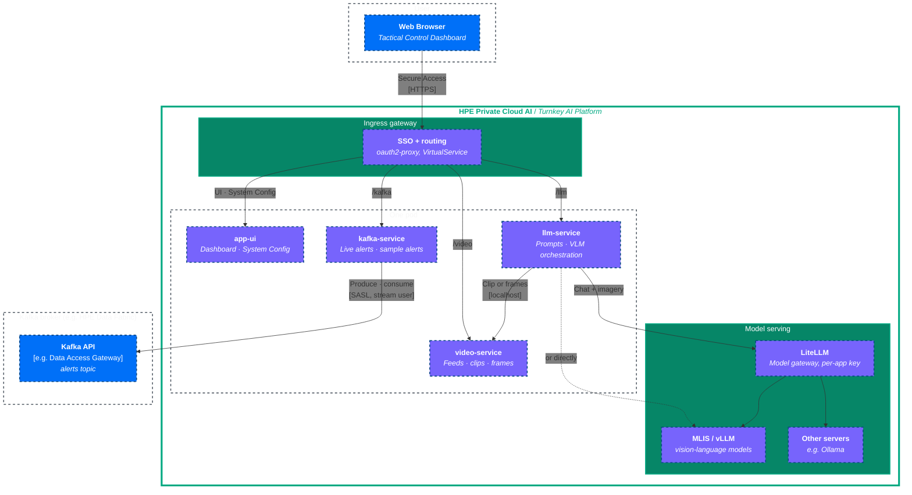

# Defence-Ops Architecture Diagram

This document gives a high-level overview of the **Defence-Ops** architecture: the services in the pod, the platform services they use, and how a question travels.

## System Architecture
 

## Service Responsibilities

### 🖥️ app-ui
- **Frontend**: A Next.js dashboard for a "Global Defence Ops Centre": four feeds, the live alert ticker and the tactical assistant.
- **Admin Configuration**: Manages the demo settings (model, Kafka broker and topic) via `/api/v1/admin/demo-config`. Only PCAI administrators can change them; the app verifies their Keycloak sign-in token.
- **Persistence**: Saves the settings to a JSON file on a Persistent Volume. It holds no secrets.

### 🤖 llm-service
- **Tactical Chat**: Combines the question, the feeds in context and the latest alerts into one request to the selected model.
- **Prompts**: Puts fixed operating rules ahead of the operator's assistant instructions: use only the imagery and alerts supplied, separate observed from assessed with a confidence level, concise military register, British English and UTC times, no targeting details. It also tells the model which images, or which part of the clip, show which feed.
- **Models**: Lists the models the app's key may use, with what each accepts (vision, video, thinking), as set in LiteLLM or, for a model served directly, in the chart's `llm.capabilities` values.
- **Visual Context**: Sends video-capable models one short Motion-JPEG clip of the feeds, other vision models still frames, and falls back to frames if a model refuses video.
- **Thinking**: Switches on the model's own reasoning when asked and supported, and returns it separately from the answer.

### 📡 kafka-service
- **Live alerts**: Streams the topic to the dashboard as Server-Sent Events at `/api/v1/kafka/stream`.
- **Sample alerts**: `/api/v1/kafka/generate` writes 3–5 alerts about the feeds in the grid (each sample video has its own set; uploads are matched by file name), or general alerts when no feed is recognised.
- **Credentials**: Connects as a user limited to the alerts topic; its credentials are a Kubernetes Secret, from the Helm values or created beforehand.

### 🎥 video-service
- **Feeds**: Lists the sample videos and uploads, and serves them to the dashboard for playback.
- **Model input**: Builds the 2 fps clips and the still frames that `llm-service` sends to the model; rejects path tricks and oversized uploads.

## Request Flow Example: Tactical Analysis

1.  **User** asks a question about the "Convoy" feed, or presses Shield or Eye on it.
2.  **app-ui** sends the question, the assistant instructions, the feed names and the latest alerts (from **kafka-service**) to **llm-service**.
3.  **llm-service** reads the selected model from the shared configuration and checks what it accepts.
4.  **llm-service** asks **video-service** for a short clip (video models) or still frames per feed (other vision models).
5.  **llm-service** calls the model through **LiteLLM**, or the model's own endpoint, with the app's own key: the operating rules and instructions, the tasking, a note of which imagery shows which feed, and the alerts.
6.  The answer, with the model's reasoning if thinking was on, appears in the dashboard.
