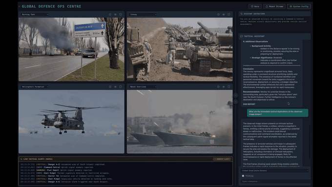
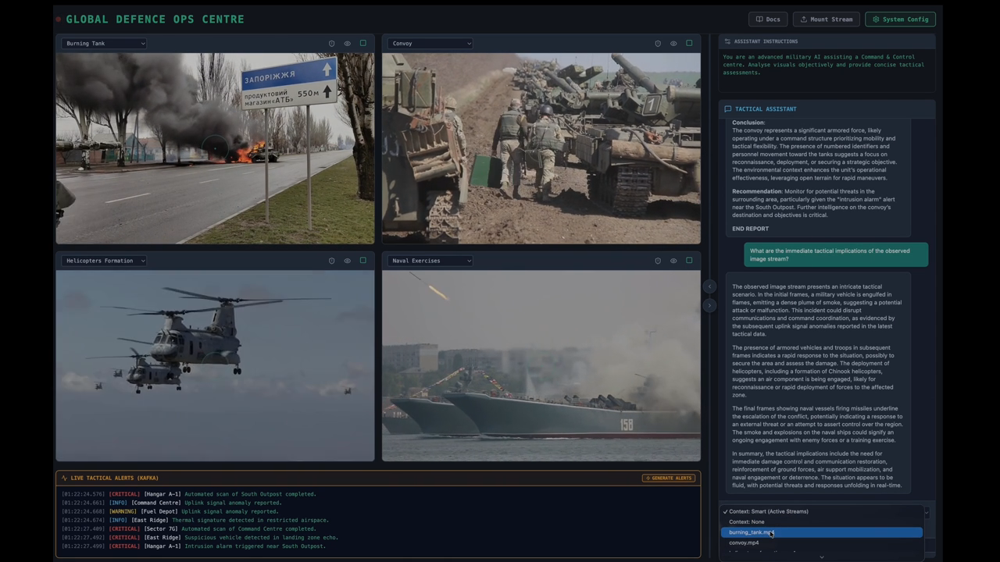
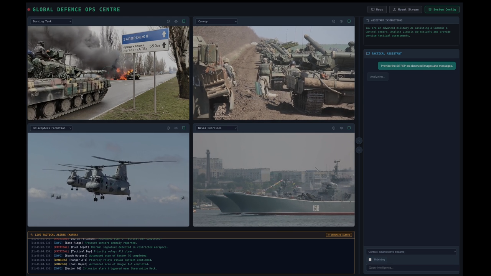
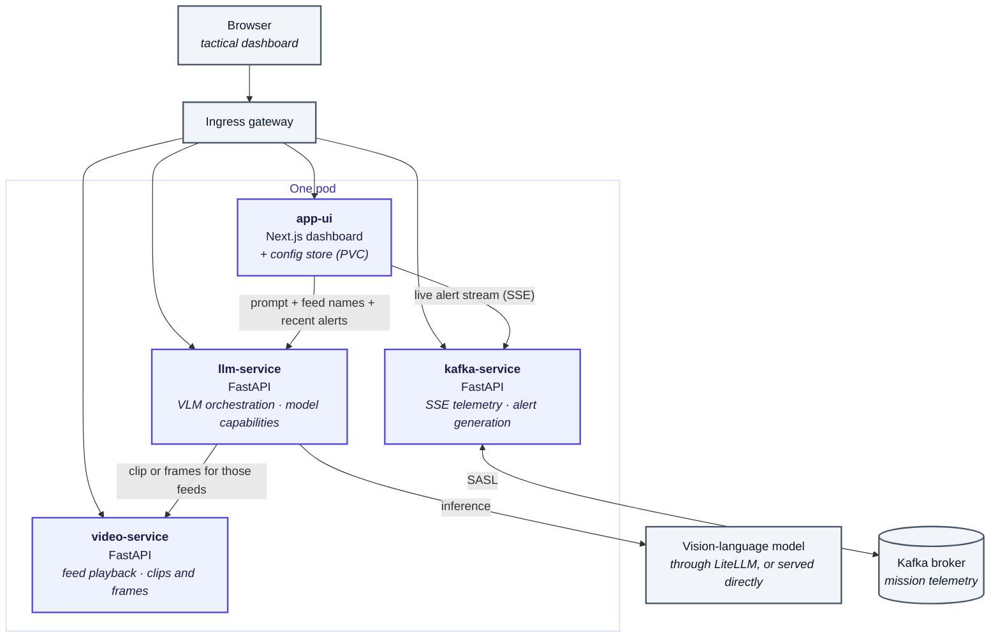

# Defence-Ops — a tactical operations centre with a vision model in the loop

> **Prerequisites** — requires [HPE Private Cloud AI](https://www.hpe.com/us/en/hpe-private-cloud-ai.html).

| Owner                 | Name              | Email                              |
| ----------------------|-------------------|------------------------------------|
| Use Case Owner        | Erdinc Kaya       | kaya@hpe.com                       |
| PCAI Deployment Owner | Erdinc Kaya       | kaya@hpe.com                       |

[**Demo video**](https://storage.googleapis.com/ai-solution-engineering-videos/public/DefenceOps.mp4)

An operations centre watches more video than anyone can actually watch. **Defence-Ops**
is a demo of what changes when a vision-language model watches it with you: four live
feeds in a grid, a telemetry ticker alongside them, and an assistant that answers
questions about *what is on screen right now* — "how many vehicles are in this
convoy?", "give me the SITREP across all feeds" — instead of about a document
someone wrote earlier. Every part of it runs on infrastructure you control: the model
endpoint is one you configure, the video never leaves your cluster, and there is no
external AI service in the path. It is built as a reference for anyone evaluating
private, on-premises AI for work where the footage cannot go to a public API — and as
a concrete example of wiring a multimodal model to real-time streams rather than to a
chat box.



<table>
<tr>
<td width="50%"></td>
<td width="50%"></td>
</tr>
<tr>
<td><em>The model's assessment cites what it can see in the frames it was given.</em></td>
<td><em>"Smart Context" sends frames from every playing feed plus recent telemetry in one question.</em></td>
</tr>
</table>

## How it works

Four services, each doing one job, running as four containers in one pod
(`deployment/defence-ops`), each on its own port behind one Service: `app-ui` 3000,
`kafka-service` 8001, `llm-service` 8002, `video-service` 8003. Models come from an
OpenAI-compatible endpoint, usually the cluster's LiteLLM proxy, through the app's own
key. The UI saves the configuration (model, Kafka broker and topic) to `config.json` on
the `app-data` volume, and the other services read it from there. Secrets are not part
of it: the model key and
the Kafka credentials are Kubernetes Secrets that only llm-service and kafka-service
read, and only PCAI administrators can change the configuration.



A question travels: the UI sends the question, the names of the feeds in context and
the latest telemetry to `llm-service`. That service checks what the selected model
accepts, as LiteLLM or the chart's values declare it: video-capable models get one short Motion-JPEG clip
of the feeds, other vision models still frames, and a model that refuses video gets
frames from then on. Thinking mode is switched on only for models that support it, and the model's
reasoning comes back separately from the answer. The model is told which images show
which feed, and fixed operating rules come ahead of the operators' own instructions:
answer only from the imagery and alerts supplied, separate what is observed from what
is assessed, keep a concise military register, and give no targeting details. The
**Generate Alerts** button writes sample alerts about the feeds in the grid, so the
ticker and the imagery tell one story. [DIAGRAM.md](./DIAGRAM.md) has the
detailed version.

| Service | Stack | Responsibility |
|---|---|---|
| `app-ui` | Next.js 16, React 19 | Dashboard, admin, and the shared configuration store |
| `video-service` | FastAPI | Feed playback, uploads, clips and frames for inference |
| `llm-service` | FastAPI | Prompts, model capabilities and vision-language inference via an OpenAI-compatible endpoint |
| `kafka-service` | FastAPI | Live alerts over Server-Sent Events, sample alerts matched to the feeds |

## What you need

- **[HPE Private Cloud AI](https://www.hpe.com/us/en/hpe-private-cloud-ai.html)**
  (PCAI), which supplies the cluster, the ingress with single sign-on and Keycloak.
  The app is built and tested on PCAI.
- A **vision-language model** (it must accept images, not just text) behind an
  OpenAI-compatible endpoint the cluster can reach, and a key for this app. Either:
  - a **[LiteLLM](https://docs.litellm.ai/) proxy** with a virtual key. Administrators can
    then switch between models, and LiteLLM declares what each accepts. LiteLLM is not part
    of every PCAI installation; the chart expects it at
    `http://litellm.litellm.svc.cluster.local:4000` unless you set `llm.baseUrl`; or
  - **one model served directly**, such as an HPE Machine Learning Inference Software
    (MLIS) deployment and a token for it.
- *Optional:* a **Kafka broker** for the live alert ticker, such as the Kafka API of HPE
  Data Fabric, with a topic and a user that may produce to and consume from it. Without
  one the dashboard runs without the ticker.
- A default StorageClass: the app keeps its settings on a 100 MiB volume.
- Access to Docker Hub for the images (`erdincka/defence-ops-*`). In an air-gapped
  cluster, mirror them and set the image repositories (see [Values](#values)).

## Set up the model endpoint

### Through LiteLLM

1. **Add your vision model(s)** to LiteLLM, from any OpenAI-compatible server: HPE
   Machine Learning Inference Software, vLLM, Ollama and so on.
2. **Declare what each model accepts.** Models do not report their capabilities through
   LiteLLM, and LiteLLM knows them only for models in its own catalogue. Add the flags to
   each model's **Model Info** (LiteLLM admin UI: *Models + Endpoints* → the model →
   *Edit Settings*), keeping the fields already there:
   ```json
   "supports_vision": true,
   "supports_video_input": false,
   "supports_reasoning": true
   ```
   | Flag | The app |
   |---|---|
   | `supports_vision` | sends still frames of the feeds (also when the flag is unset) |
   | `supports_video_input` | sends one short Motion-JPEG clip of the feeds instead of frames |
   | `supports_reasoning` | offers the **Thinking** switch for the model |

   Video goes through LiteLLM only to vLLM-served models (tested with one); for
   Ollama models LiteLLM rejects video before the model sees it, so leave
   `supports_video_input` false there. A model that refuses a clip gets frames anyway.
3. **Create a virtual key** for this app (*Virtual Keys*), limited to the models it
   should use. The app lists exactly the models this key may use.

### A model served directly

The app can call one model's own OpenAI-compatible endpoint, such as an MLIS deployment,
with no LiteLLM in between. It uses only `/v1/models` and `/v1/chat/completions`.

1. **Note the endpoint and a token.** For MLIS, the endpoint is the URL the deployment
   shows, and the token is one created for that deployment. Tokens expire: when one
   does, questions fail with HTTP 401 or 403 until the app has a new one.
2. **Note the model's name**, the `id` that the endpoint lists:
   ```bash
   curl -s -H "Authorization: Bearer $MODEL_TOKEN" https://<endpoint>/v1/models
   ```
3. **Say what the model accepts.** A model served directly declares none of this, so
   set it in the values from the model's documentation:
   ```yaml
   llm:
     baseUrl: https://<endpoint>      # without /v1
     apiKey: <token>                  # or llm.existingSecret
     model: <id from /v1/models>
     capabilities:
       vision: true                   # required: the app sends still frames
       video: false                   # true sends one short clip instead (vLLM, video-capable model)
       reasoning: false               # true offers the Thinking switch
   ```
   Set `reasoning: true` for a model with a thinking mode (switched with
   `chat_template_kwargs.enable_thinking` or `reasoning_effort`). Otherwise a model
   that thinks by default always does, and answers take longer. Video and thinking were
   tested this way with a Nemotron VL model on MLIS.

One endpoint serves one model, so System Config offers only that one. The app checks
the endpoint's TLS certificate against the certificate authorities in `SSL_CERT_FILE`.
On PCAI that is the platform's own bundle, which PCAI mounts into every pod, so the
app trusts what the platform trusts. Elsewhere it is the public authorities.

## Install on Private Cloud AI

1. Download the latest chart package and the logo. There's no need to clone the
   repository or build anything; the images come from Docker Hub.
   ```bash
   curl -LO https://github.com/ai-solution-eng/ai-solution-demos/raw/main/vertical-demos/defence-ops/charts/defence-ops-0.4.0.tgz
   curl -LO https://github.com/ai-solution-eng/ai-solution-demos/raw/main/vertical-demos/defence-ops/defence-ops.png
   ```
   [`charts/`](./charts) always holds the latest release's package, built from
   [`helm/`](./helm).
2. In PCAI, under **Tools & Frameworks**, choose **Import Framework**. Give it the chart
   (`defence-ops-0.4.0.tgz`), the logo (`defence-ops.png`) and a namespace, then set
   the values:
   - Keep the `ezua` block as it is: PCAI fills in `${DOMAIN_NAME}` and
     `${OIDC_CLIENT_ID}`.
   - `llm.apiKey`: the app's key for the model endpoint (or `llm.existingSecret`,
     below). `llm.model`: the model to start with. For a model served directly, also
     `llm.baseUrl` and `llm.capabilities` (see above).
   - For live alerts: `kafka.broker`, `kafka.topic`, `kafka.username` and
     `kafka.password` (or `kafka.existingSecret`), and `kafka.securityProtocol` and
     `kafka.saslMechanism` if your broker differs from SASL_PLAINTEXT with PLAIN.
3. Open the app from its tile, at `https://defence-ops.<your PCAI domain>`.

To upgrade, import the new chart version the same way with the same values. The
settings saved on System Config stay on the app's volume.

### Credentials: values or an existing Secret

Credentials given as values (`llm.apiKey`, `kafka.username`, `kafka.password`) go into
Secrets the chart creates. They are also stored in the app's imported configuration and
its Helm release, where cluster administrators can read them. To keep them out of
there, create the Secrets yourself before importing, and name them in the values instead:

```bash
kubectl -n <namespace> create secret generic defence-ops-llm --from-file=api-key=<file with the key>
kubectl -n <namespace> create secret generic defence-ops-kafka \
  --from-file=username=<file with the user> --from-file=password=<file with the password>
```

```yaml
llm:
  existingSecret:
    name: defence-ops-llm
    key: api-key
kafka:
  existingSecret:
    name: defence-ops-kafka   # keys username and password
```

An existing Secret wins when both are set.

### Other Kubernetes clusters

The chart also installs with plain Helm on a cluster with Istio and an oauth2-proxy
external authoriser like PCAI's. Set the values PCAI would fill in:

```bash
helm install defence-ops ./defence-ops-0.4.0.tgz --namespace defence-ops --create-namespace \
  --set ezua.domainName=<your domain> \
  --set ezua.oidc.client_id=<OIDC client the sign-in uses> \
  --set ezua.virtualService.endpoint=defence-ops.<your domain> \
  --set llm.existingSecret.name=defence-ops-llm
```

That path is not the supported one.

### Values

| Value | Default | Purpose |
|---|---|---|
| `ezua.domainName` | `${DOMAIN_NAME}` | Cluster domain; the Keycloak issuer is `https://keycloak.<domain>/realms/UA` |
| `ezua.oidc.client_id` | `${OIDC_CLIENT_ID}` | Audience of the sign-in token that identifies administrators |
| `ezua.virtualService.endpoint` | `defence-ops.${DOMAIN_NAME}` | Hostname of the app |
| `llm.baseUrl` | `http://litellm.litellm.svc.cluster.local:4000` | Model endpoint, without `/v1`: LiteLLM or a model served directly |
| `llm.apiKey` / `llm.existingSecret` | none | The app's key for that endpoint |
| `llm.model` | none | Model until an administrator picks one |
| `llm.maxImages` | `5` | Frames per question for models without video |
| `llm.capabilities.vision`, `.video`, `.reasoning` | empty (unknown) | What the model accepts where the endpoint does not declare it: `true` or `false` |
| `kafka.broker`, `kafka.topic` | none | Kafka target until an administrator sets one |
| `kafka.securityProtocol` | `SASL_PLAINTEXT` | `PLAINTEXT`, `SSL`, `SASL_PLAINTEXT` or `SASL_SSL` |
| `kafka.saslMechanism` | `PLAIN` | `PLAIN`, `SCRAM-SHA-256` or `SCRAM-SHA-512` |
| `kafka.username`, `kafka.password` / `kafka.existingSecret` | none | Kafka credentials |
| `settings.adminRole` | `admin` | Realm role allowed to change System Config |
| `settings.oidcJwksUrl` | Keycloak's in-cluster Service | Where the signing keys are fetched |
| `<service>.image.repository`, `<service>.image.tag` | `erdincka/defence-ops-<service>`, `global.image.tag` | Images (`appUi`, `kafkaService`, `llmService`, `videoService`) |
| `networkPolicy.enabled` | `true` | Admit only the ingress gateway to the pod |

### First run

Open **System Config** in the navigation bar. It shows the model and Kafka target from
the values until someone saves their own. Only PCAI administrators can change them:
PCAI's sign-in passes the user's Keycloak ID token to the app, which checks it against
Keycloak's keys and looks for the realm role `admin` in its `groups` claim (where PCAI
puts realm roles) or in `realm_access.roles`. Everyone else sees System Config
read-only, with the reason. If your tokens carry the role under another name, set
`settings.adminRole`.

Then pick a feed in any grid cell and press play. First load of each video is slow
while it is fetched and cached; after that it is instant.

- The **shield** icon asks for a threat assessment of that feed; the **eye** icon for a
  SALUTE report of what it shows.
- The chat box takes anything else, typed or picked from the sample questions above it.
  Choose **Smart Context** to ask across every playing feed plus recent alerts, or scope
  it to one feed. **Thinking** mode shows the model's reasoning before its answer.

[USAGE.md](./USAGE.md) is the full walkthrough; [EXAMPLES.md](./EXAMPLES.md) has
questions that demo well.

## Development

This copy leaves out the demo's Tilt dev loop, as this repository keeps no Tiltfiles.
The demo is maintained in [erdincka/defence-ops](https://github.com/erdincka/defence-ops):
develop there, with live reload on a PCAI cluster, and each release is copied here.

To publish images, sign in to your registry and pass the version; `IMAGE_PREFIX` is the
registry and account (default `erdincka` on Docker Hub). The script pushes only that tag.

```bash
IMAGE_PREFIX=registry.example.com/team ./scripts/publish_images.sh 1.4.0
```

Then set `global.image.tag` (and the image repositories, for another prefix) in
`helm/values.yaml`. To release, bump `version` in `helm/Chart.yaml`, swap the package in
`charts/` for the new one, and update the version in the download commands above:

```bash
git rm -q charts/defence-ops-<previous version>.tgz
helm package helm --destination charts
```

Each Python service is a uv project (`pyproject.toml`, `uv.lock`) with its own tests;
run them in a container, for example:

```bash
docker run --rm -v "$PWD":/work -w /work/llm-service python:3.12-slim sh -c 'pip install -q uv==0.13.6 && UV_PROJECT_ENVIRONMENT=/tmp/venv uv run --frozen pytest -q'
```

## Provenance, and a note on the sample videos

This demo was developed as part of my work at HPE, and the sample footage in
`assets/videos/` is included here under HPE's rights to redistribute it.

That permission does not extend to you. The clips remain third-party copyrighted
material: you may run them as part of this demo, but **not** reuse them in your
own products or redistribute them separately — see
[assets/videos/README.md](./assets/videos/README.md). For your own deployment,
substitute your own material; `video-service` picks up any `.mp4` or `.mov`
dropped in that directory, no configuration needed.

## Licence

The code, configuration and documentation here are MIT — see [LICENSE](./LICENSE).
The sample footage in `assets/videos/` is **excluded** from that
grant and stays under the terms above.

---

Demonstration software. Not a targeting system, not an operational tool, and not
built or validated for real-world military use.

© 2026 HPE. For demonstration purposes only.
